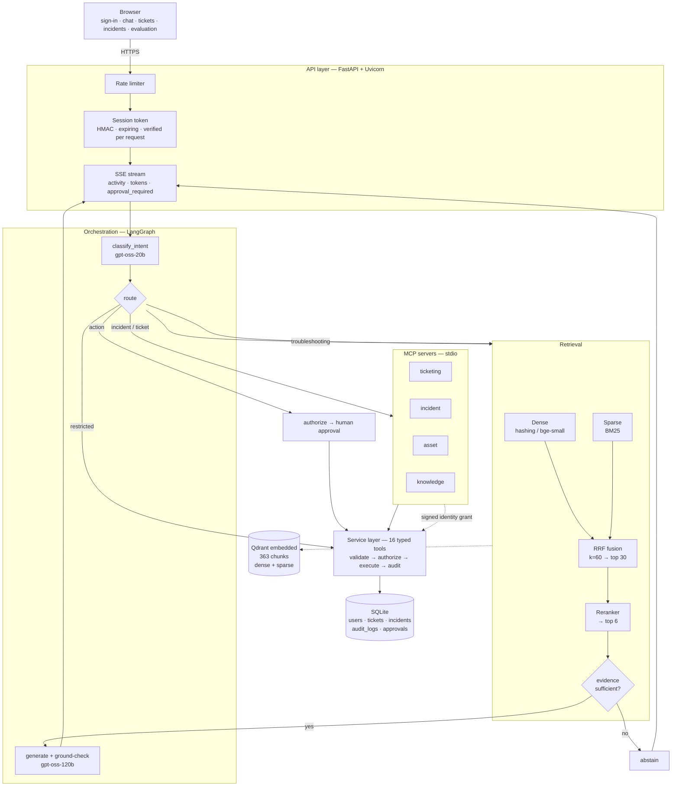
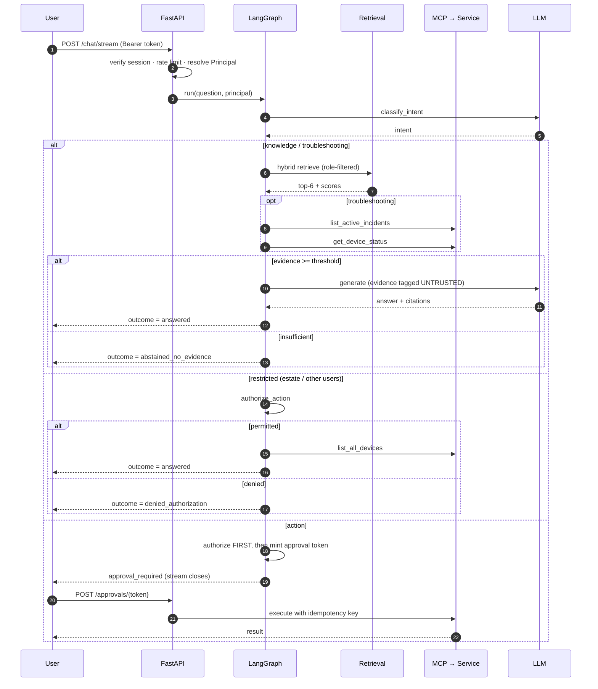

# OpsPilot AI — Design Document

The single entry point. Architecture diagrams, the decision record for every
layer, and what remains.

| Companion | Contents |
| --- | --- |
| [`audit/SPEC-AUDIT.md`](audit/SPEC-AUDIT.md) | Where the original spec was insufficient or contradictory |
| [`architecture/TECHNOLOGY-RATIONALE.md`](architecture/TECHNOLOGY-RATIONALE.md) | 18 comparison tables — why each technology beat its alternatives |
| [`architecture/ARCHITECTURE.md`](architecture/ARCHITECTURE.md) | Layer-by-layer technology map |
| [`data/DATA-STRATEGY.md`](data/DATA-STRATEGY.md) | Corpus design, licences, gold-label protocol |
| [`DIVERGENCE.md`](DIVERGENCE.md) | Section-by-section status against all 44 spec sections |
| [`PENDING.md`](PENDING.md) | What is blocked, why, and what stands in its place |

---

## 1. What this system is

A **retrieval-grounded, tool-using IT copilot** with server-side authorization
and human-in-the-loop approval, where tools are reached over MCP.

It is **RAG** (answers come from documents, with citations), **an agent** (it
also reads live tickets, incidents and devices), and **an MCP application** (that
is the transport). It is deliberately **not** autonomous — consequential actions
stop for human approval — and **not** multi-agent.

---

## 2. System architecture

---

## 3. Request flow with the three outcomes

The system has **three distinct terminal states**, and conflating them is a bug
(it was one — see §6).

**Why the stream closes on approval:** SSE cannot block for human input. The
stream emits `approval_required` with a single-use token and ends; approval is a
separate request that resumes the checkpointed graph. This is the strongest
justification for LangGraph in the system.

---

## 4. Trust boundaries

```mermaid
flowchart LR
    subgraph T["TRUSTED — may carry instructions"]
        SYS["System prompt"]
        UT["User turn"]
    end
    subgraph UNT["UNTRUSTED — data only, never instructions"]
        KB["Retrieved KB passages"]
        TK["Ticket bodies / comments<br/>written by any employee"]
        TO["Tool output"]
    end

    SYS --> CTX["Context builder<br/>fences + provenance tags"]
    UT --> CTX
    KB --> SAN["sanitize + injection scan"] --> CTX
    TK --> SAN
    TO --> SAN
    CTX --> LLM["LLM"]
    LLM --> ANS["Answer"]
    UT ==>|ONLY source of tool arguments| ARGS["Tool arguments"]
    KB -.->|never| ARGS
    ARGS --> AUTHZ["Server-side authorization"] --> EXEC["Execute"]

    style UNT fill:#3a2020,stroke:#ff6b6b
    style T fill:#1e3a2a,stroke:#3ecf8e
```

The attack the original spec missed: **ticket descriptions are attacker-controlled
and later read by an IT_agent whose context carries elevated privilege.** The
defence is structural — untrusted tiers can never become instructions, and tool
arguments derive only from the user turn.

---

## 5. Decisions, with the alternatives rejected

Condensed; full tables with trade-offs in
[`TECHNOLOGY-RATIONALE.md`](architecture/TECHNOLOGY-RATIONALE.md).

| Layer | Chosen | Rejected, and why |
| --- | --- | --- |
| Knowledge approach | **RAG** | Fine-tuning — no citations, no per-role access control (disqualifying), retrain per policy change. Long-context stuffing — 190k chars ≈ 6 min of the token budget per question. |
| Vector store | **Qdrant embedded** | pgvector (no sparse arm, needs a server); FAISS (no payload filtering — the RBAC filter rules it out); Chroma (weaker filtering). |
| Dense retrieval | **Hashing (by constraint)** → ONNX bge-small | sentence-transformers (no Python 3.14 support, needs torch); hosted embedding API (Groq has none — second vendor). |
| Sparse | **Own BM25** | `rank_bm25` — no IDF access for sparse vectors, no control over identifier tokenisation, which is where `ERR_VPN_809` retrieval is won. |
| Fusion | **RRF, Python-side** | Weighted score fusion (hidden normalisation constants); Qdrant server-side fusion (used in production, but collapses the per-arm lists the analysis needs). |
| Reranking | **Feature reranker** | Cross-encoder (written, model blocked); Cohere (vendor + hop). |
| Orchestration | **LangGraph** | Plain functions (fine until HITL, then you write a worse checkpointer); CrewAI/AutoGen (multi-agent theatre for a deterministic workflow); Temporal (right at scale, overkill here). |
| Tool protocol | **MCP over stdio** | Claiming MCP improves performance — it does not. It is ~25× a function call when warm. The honest benefit is interoperability. |
| MCP identity | **HMAC-signed per-call grant** | Plain `employee_id` argument (model-controlled = spoofable); env-pinned identity (measured: one process per user, 4–7 s cold start each). |
| Relational | **SQLite, Postgres-shaped** | Putting tickets/audit in the vector DB — spec §13 forbids it, and it needs transactions and exact filters. |
| Streaming | **SSE** | WebSockets (bidirectional not needed, more proxy friction); long polling (worse latency). |
| LLM provider | **Groq + deterministic fake** | Local model (15.5 GB RAM, no GPU — single-digit tok/s). The fake provider is why 42 tests run in 4 s with zero API calls. |
| Judge model | **qwen3.8-27b** | gpt-oss-120b — that is the generator; self-evaluation. (`llama-3.3-70b` is **not available** on this account.) |

---

## 6. A bug worth documenting

Asking *"Show me every employee's device information"* as an employee produced:

> *"I could not find enough evidence in the IT knowledge base…"*

Security held — `list_all_devices` was never called. But the **explanation was
false**: the data exists, the caller simply may not see it. The router had no
category for bulk/other-user requests, so it fell through to RAG, retrieved
nothing above threshold, and abstained.

Fixed by adding a `restricted` intent that authorizes *before* touching data, and
by making `outcome` first-class state with three distinct values. Now:

| Role | Intent | Outcome | Tool called |
| --- | --- | --- | --- |
| employee | `restricted` | `denied_authorization` | **none** |
| IT_admin | `restricted` | `answered` | `list_all_devices` (121 devices) |

The lesson generalises: **"no evidence" and "not permitted" are different facts,
and showing the first for the second teaches users the wrong model of the system.**

---

## 7. Measured results

Full detail: `artifacts/reports/EVALUATION_SUMMARY.md`.

**Retrieval** (240 docs, 363 chunks, 173 scored queries):

| Experiment | Recall@10 | MRR | nDCG@10 |
| --- | ---: | ---: | ---: |
| E1 Dense | 0.674 | 0.439 | 0.324 |
| E2 Sparse (BM25) | 0.744 | 0.484 | 0.406 |
| E3 Hybrid (RRF) | 0.732 | 0.483 | 0.372 |
| **E4 Hybrid + reranker** | **0.829** | **0.709** | **0.511** |

Three findings: BM25 beats dense **2×** on exact identifiers (0.654 vs 0.315);
**fusion improves the candidate pool even though it worsens the fused ordering**
(pool recall@30 0.914 hybrid vs 0.887 sparse-only; dense contributes 14 gold
documents BM25 never finds) — judging fusion by nDCG of its own ordering was the
wrong metric, since the reranker re-scores the pool anyway; reranking is the
largest win (+0.139, CI `[+0.110, +0.166]`), driven by version-staleness
(0.133→0.519) and distractors (0.191→0.416).

**Abstention:** three tiers. On the 446-document corpus: hard refusal **17.7%**
(down from 37.0%) and confident-wrong **6.7%** (down from 12.1%) — better on
both axes. 35.7% receive a hedged, cited partial answer. The residual refusals
are almost entirely paraphrase and multi-hop queries — the embedding gap, not
the gate.

**A threshold is corpus-dependent.** Widening the corpus pushed confident-wrong
to 26.7% at the old setting and forced a re-sweep. CI now enforces a safety
ceiling on that metric.

**Security:** **5/5 authorization probes**; injection detection 78.1% recall
(regex) / 81.2% with Prompt Guard 2, which costs +14pp false positives.

**Generation:** relevance 0.643 [0.357, 0.857] at kappa 1.00 (n=14, *reliable*);
faithfulness 1.000 (n=6) marked **UNTESTED** because the labels contain no
negative examples.

**Suite:** 42 tests · 7/7 MCP checks · 9/9 end-to-end scenarios · 7/7 eval stages.

---

## 8. The constraint that shaped everything

Groq free tier, measured: **8,000 tokens/minute**, ~2,400 per grounded answer —
about **three answers per minute**. Demonstrated live: eight requests in a minute
hit 7,722/8,000 and the guard returned a clean 503 *before* Groq could 429.

Consequences, each of which is a better design on its own merits:

1. **Retrieval evaluation is LLM-free** — the most rigorous measurement costs nothing.
2. **Caching is justified by quota, not latency** — a hit returns budget.
3. **Models are tiered by task** — 20b routes, 120b only writes the final answer.
4. **The budget is enforced before the call**, not discovered as a 429.
5. **Five of seven evaluation stages need no model access at all.**

---

## 9. What remains

See [`PENDING.md`](PENDING.md). The short version:

- **Biggest quality gap:** neural embeddings blocked by the proxy. Code written, one flag away.
- **Biggest process gap:** no CI. 42 tests exist and nothing enforces them.
- **Biggest security gap:** authentication is passwordless. Authorization is real and tested.
- **Unverifiable here:** Docker, Kubernetes, load testing.
